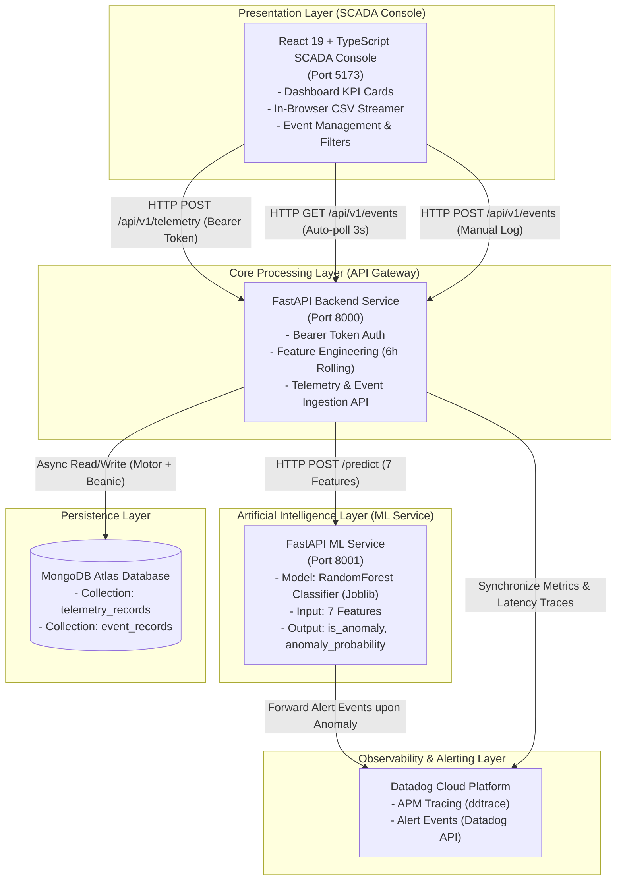
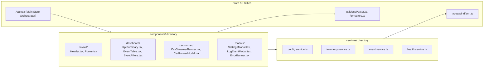

# 📐 System Architecture — WindFarm HKT

This document specifies the end-to-end system architecture, distributed microservices topology, real-time data flow pipelines, and database schemas for **WindFarm HKT**.

---

## 1. High-Level System Topology

The system is architected as a **distributed microservices** platform ensuring high availability, service decoupling, and independent horizontal scalability:



---

## 2. Real-Time Sequence Data Flow

The following sequence diagram illustrates the lifecycle of a sensor telemetry record from ingestion through AI inference, database persistence, and SCADA dashboard display:


---

## 3. Microservices Component Breakdown

### 3.1. Frontend SCADA Console
* **Directory:** [`frontend/`](file:///c:/WindFarm/frontend)
* **Core Technologies:** React 19, TypeScript, Vite 8, Lucide React, React-Toastify.
* **Design Philosophy:** Midnight Blue & Cyan SCADA industrial theme (`#060b17`, `#0b1426`, `#0891b2`, `#38bdf8`), high data legibility, zero glare, and immediate visual distinction of anomalies.
* **Modular Structure:**
  - `components/layout/`: Header with real-time backend connection monitor, Footer.
  - `components/dashboard/`: 3 KPI summary cards, SCADA data table, search & filtering strip.
  - `components/csv-runner/`: Quick status banner and in-browser CSV telemetry streaming modal.
  - `components/modals/`: API Bearer token settings modal, manual event logging modal.
  - `services/`: Decoupled API service clients (`telemetry`, `event`, `config`, `health`).

### 3.2. Backend API Gateway & Feature Engine
* **Directory:** [`backend/src/`](file:///c:/WindFarm/backend/src)
* **Core Technologies:** FastAPI, Beanie ODM, Motor, Pydantic v2.
* **Service Port:** `8000`
* **Core Responsibilities:**
  - Telemetry ingestion through `POST /api/v1/telemetry`.
  - Centralized security verification via Bearer Token middleware (`core/security.py`).
  - **Dynamic Feature Engineering Pipeline:** Computes 6-hour rolling aggregations on the fly before passing features to the ML Service.
  - Event management and query filtering through `GET /api/v1/events`.
  - Manual incident creation via `POST /api/v1/events`.

### 3.3. Machine Learning Prediction Service
* **Directory:** [`backend/ml_service/`](file:///c:/WindFarm/backend/ml_service)
* **Core Technologies:** FastAPI, Scikit-learn 1.6.1, Pandas, Joblib.
* **Service Port:** `8001`
* **Model Artifact:** `RandomForestClassifier` serialized in `wind_turbine_anomaly_model.joblib`.
* **7 Input Features:**
  1. `wind_speed` (m/s): Instantaneous wind velocity.
  2. `power_output` (kW): Active turbine electrical power generated.
  3. `ambient_temp` (°C): Ambient environmental temperature.
  4. `status_type_id`: Integer turbine operational status code.
  5. `wind_speed_roll_mean_6h`: 6-hour rolling mean of wind speed.
  6. `power_roll_std_6h`: 6-hour rolling standard deviation of power output.
  7. `theoretical_power_index`: Ratio index comparing theoretical power curve against actual output.
* **Outputs:** Binary classification `is_anomaly` (boolean) and confidence score `anomaly_probability` (float).

---

## 4. Database Schema (MongoDB Atlas)

The system utilizes MongoDB Atlas with two core collections managed through Beanie ODM documents:

### 4.1. Collection `telemetry_records`
Stores high-frequency sensor readings alongside calculated derived features:
```json
{
  "_id": "ObjectId('...')",
  "asset_id": 1,
  "time_stamp": "2026-11-04T08:30:00Z",
  "wind_speed": 12.4,
  "power_output": 1850.5,
  "ambient_temp": 24.2,
  "status_type_id": 1,
  "wind_speed_roll_mean_6h": 11.8,
  "power_roll_std_6h": 142.3,
  "theoretical_power_index": 0.96,
  "is_anomaly": false,
  "anomaly_probability": 0.05,
  "created_at": "2026-11-04T08:30:01Z"
}
```

### 4.2. Collection `event_records`
Stores operational incidents, automatic AI anomaly alarms, and manual maintenance logs:
```json
{
  "_id": "ObjectId('...')",
  "event_id": 1024,
  "asset_id": 3,
  "event_label": "anomaly",
  "event_start": "2026-11-04T09:15:00Z",
  "event_end": "2026-11-04T09:45:00Z",
  "event_description": "Blade Pitch Control Angle Mismatch detected under high wind velocity",
  "created_at": "2026-11-04T09:15:02Z"
}
```

---

## 5. Frontend Modular Architecture

Frontend components and services follow a strict Separation of Concerns (SoC) design:


