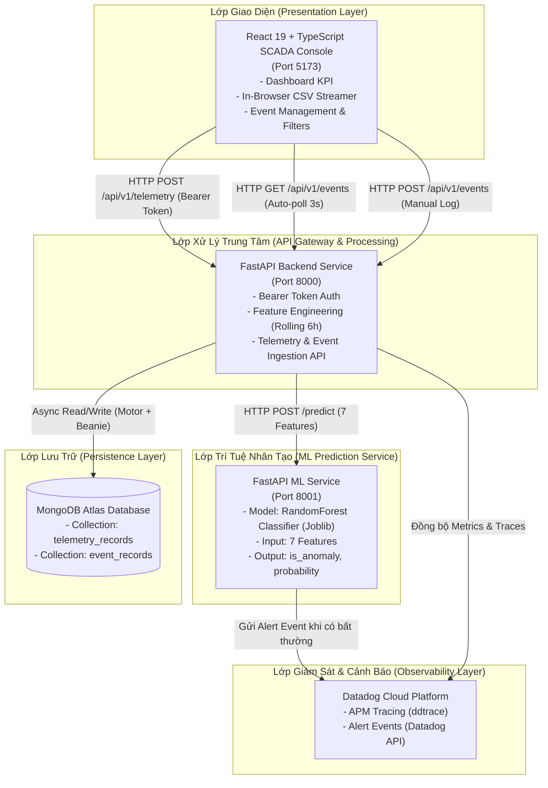
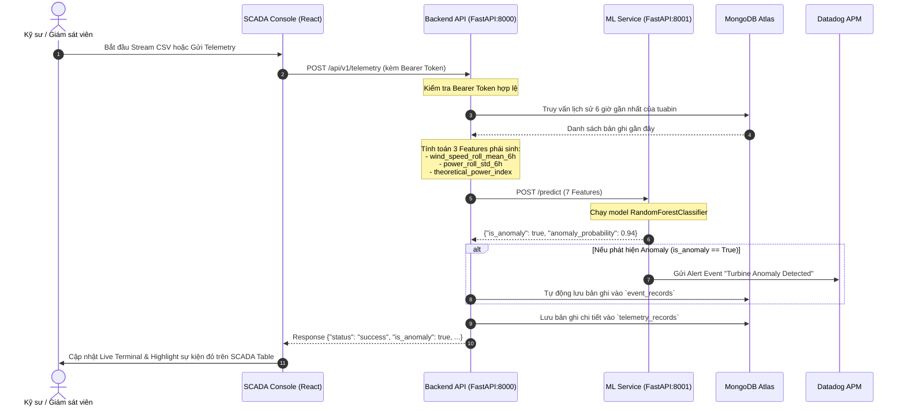

# 📐 Kiến Trúc Hệ Thống (System Architecture) — WindFarm HKT

Tài liệu này đặc tả toàn bộ kiến trúc tổng thể, mô hình phân tầng Microservices, luồng dữ liệu thời gian thực và lược đồ cơ sở dữ liệu của hệ thống **WindFarm HKT**.

---

## 1. Sơ Đồ Kiến Trúc Tổng Thể (High-Level Topology)

Hệ thống được thiết kế theo mô hình **Microservices phân tán** đảm bảo tính độc lập, khả năng mở rộng (scalability) và tính sẵn sàng cao (high availability):



---

## 2. Luồng Dữ Liệu Thời Gian Thực (Sequence Data Flow)

Dưới đây là sơ đồ tuần tự biểu diễn quá trình từ khi một bản ghi cảm biến (telemetry) được nạp vào cho đến khi hiển thị kết quả chẩn đoán trên bảng điều khiển SCADA:



---

## 3. Chi Tiết Các Thành Phần Hệ Thống

### 3.1. Giao Diện SCADA (Frontend Console)
* **Vị trí:** [`frontend/`](file:///c:/WindFarm/frontend)
* **Công nghệ:** React 19, TypeScript, Vite 8, Lucide React, React-Toastify.
* **Phong cách thiết kế:** Giao diện trung tâm điều khiển SCADA công nghiệp (Midnight Blue + Cyan SCADA), loại bỏ hiệu ứng phát sáng neon gây mỏi mắt, ưu tiên độ tương phản và phát hiện bất thường ngay lập tức.
* **Cấu trúc module:**
  - `components/layout/`: Thanh Header với trạng thái kết nối backend realtime, thanh Footer.
  - `components/dashboard/`: 3 thẻ KPI tổng quan, Bảng dữ liệu sự kiện, Thanh tìm kiếm & bộ lọc.
  - `components/csv-runner/`: Banner tóm tắt trạng thái file và Modal Stream Telemetry từ file CSV.
  - `components/modals/`: Modal cài đặt API Token, Modal ghi nhận sự kiện thủ công.
  - `services/`: Tầng gọi API tách biệt (`telemetry`, `event`, `config`, `health`).

### 3.2. Backend API Gateway
* **Vị trí:** [`backend/src/`](file:///c:/WindFarm/backend/src)
* **Công nghệ:** FastAPI, Beanie ODM, Motor, Pydantic v2.
* **Cổng dịch vụ:** `8000`
* **Nhiệm vụ chính:**
  - Tiếp nhận các bản ghi cảm biến thông qua `POST /api/v1/telemetry`.
  - Xác thực bảo mật tập trung qua Bearer Token Middleware (`core/security.py`).
  - Thực hiện công đoạn **Feature Engineering động** (Dynamic Feature Engineering) trước khi chuyển dữ liệu sang bộ dự đoán AI.
  - Cung cấp API truy xuất danh sách sự kiện có lọc và phân trang `GET /api/v1/events`.
  - Cung cấp API ghi nhận sự kiện thủ công `POST /api/v1/events`.

### 3.3. ML Prediction Service
* **Vị trí:** [`backend/ml_service/`](file:///c:/WindFarm/backend/ml_service)
* **Công nghệ:** FastAPI, Scikit-learn 1.6.1, Pandas, Joblib.
* **Cổng dịch vụ:** `8001`
* **Mô hình máy học:** `RandomForestClassifier` lưu trữ trong file `wind_turbine_anomaly_model.joblib`.
* **7 Features đầu vào:**
  1. `wind_speed` (m/s): Tốc độ gió tức thời.
  2. `power_output` (kW): Công suất phát điện thực tế.
  3. `ambient_temp` (°C): Nhiệt độ môi trường bên ngoài tuabin.
  4. `status_type_id`: Mã trạng thái vận hành của tuabin.
  5. `wind_speed_roll_mean_6h`: Tốc độ gió trung bình trong 6 giờ gần nhất.
  6. `power_roll_std_6h`: Độ lệch chuẩn của công suất phát trong 6 giờ gần nhất.
  7. `theoretical_power_index`: Chỉ số tương quan giữa công suất lý thuyết theo đường cong công suất và công suất thực tế.
* **Đầu ra:** Nhãn nhị phân `is_anomaly` (True/False) cùng xác suất dự đoán `anomaly_probability`.

---

## 4. Lược Đồ Cơ Sở Dữ Liệu (MongoDB Atlas Schema)

Hệ thống sử dụng MongoDB Atlas với 2 collection chính được định nghĩa qua Beanie ODM:

### 4.1. Collection `telemetry_records`
Lưu trữ toàn bộ dữ liệu cảm biến đo đạc theo chuỗi thời gian cùng các chỉ số đã được xử lý:
```json
{
  "_id": "ObjectId('...')",
  "asset_id": 1,
  "time_stamp": "2026-11-04T08:30:00Z",
  "wind_speed": 12.4,
  "power_output": 1850.5,
  "ambient_temp": 24.2,
  "status_type_id": 1,
  "wind_speed_roll_mean_6h": 11.8,
  "power_roll_std_6h": 142.3,
  "theoretical_power_index": 0.96,
  "is_anomaly": false,
  "anomaly_probability": 0.05,
  "created_at": "2026-11-04T08:30:01Z"
}
```

### 4.2. Collection `event_records`
Lưu trữ các biến cố, sự kiện vận hành và cảnh báo bất thường được phát hiện tự động hoặc ghi nhận thủ công:
```json
{
  "_id": "ObjectId('...')",
  "event_id": 1024,
  "asset_id": 3,
  "event_label": "anomaly",
  "event_start": "2026-11-04T09:15:00Z",
  "event_end": "2026-11-04T09:45:00Z",
  "event_description": "Blade Pitch Control Angle Mismatch detected under high wind velocity",
  "created_at": "2026-11-04T09:15:02Z"
}
```

---

## 5. Kiến Trúc Modular của Frontend

Mã nguồn Frontend được chuẩn hóa theo mô hình phân tách trách nhiệm (Separation of Concerns):


